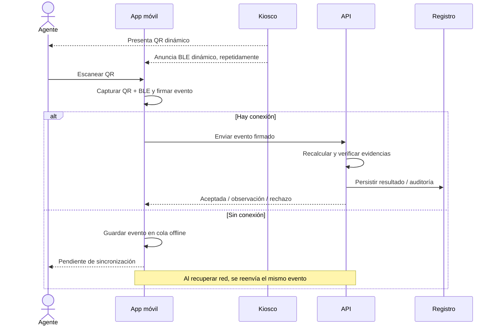

# Sistema de Asistencia Municipal — Documento maestro de contexto

**Versión:** 1.0 — consolidación de decisiones al 25 de octubre de 2026  
**Tipo:** especificación funcional y técnica de trabajo  
**Propósito:** permitir que el equipo y un nuevo chat retomen el proyecto desde las decisiones más recientes, sin reconstruir toda la conversación.  
**Estado:** diseño propuesto; **no** constituye certificación de compatibilidad BLE ni contrato definitivo entre móvil y API.

La compatibilidad de la rotación de 15 s tiene resultados de hardware del 25 de octubre de 2026 en [`results/INFORME.md`](../results/INFORME.md). Qué cierra esa demo, qué deja abierto y cuáles son los pasos siguientes están en [`results/ESTADO.md`](../results/ESTADO.md). Este documento sigue siendo el diseño del sistema.

El trabajo en curso de la app es solo móvil. Las decisiones y las pruebas de API quedan fuera de su criterio. El paso siguiente es una simulación en dispositivos: QR generado en el kiosco con un secreto mock, lector de QR en el receptor y el BLE ya medido, sin validar nada contra un servidor. Ver §11.9.

> **Criterio rector:** construir un registro de asistencia **viable, simple, robusto y escalable**, que mejore sustancialmente la operatoria existente. No se pretende una solución infalible ni introducir controles que generen más incidencias que beneficios.
>
> **Decisión transversal vigente:** **no utilizar GPS en ninguna parte de la fichada**: ni sedes fijas ni cuadrillas móviles. Si las pruebas BLE revelan limitaciones, se revisará el diseño con datos; GPS no debe reintroducirse por defecto.

## Convenciones de estado

- **[DEFINIDO]**: decisión acordada en las conversaciones. Puede evolucionar mediante una decisión explícita.
- **[PROPUESTO]**: solución técnica o regla operativa sugerida; requiere acuerdo e implementación.
- **[POR VALIDAR]**: hipótesis o compatibilidad que necesita pruebas en hardware/software real.
- **[PENDIENTE]**: dato, criterio o decisión que todavía debe cerrarse.
- **[DIFERENCIA BACKEND]**: el informe vigente del equipo de API describe algo distinto de nuestras decisiones posteriores; requiere alineación, no se presupone ya corregido.

## Resumen ejecutivo de decisiones

| Asunto | Estado | Acuerdo actual |
|---|---|---|
| Modalidad | [DEFINIDO] | Cada agente ficha entrada y salida desde su celular personal; no se imponen turnos durante la captura. |
| Evidencia de sede | [DEFINIDO] | **QR dinámico + baliza BLE rotativa**, ambos generados por el mismo kiosco. |
| Rotación | [DEFINIDO] | QR y contenido de la baliza cambian **cada 15 segundos**. BLE emite anuncios continuamente durante la ventana. |
| Criptografía | [DEFINIDO] | **Clave secreta individual por kiosco**; QR y BLE contienen **valores diferentes**, derivados de esa identidad/clave y del período temporal. |
| GPS | [DEFINIDO] | **Excluido** de las fichadas normales, de contingencia y de cuadrillas. |
| Conectividad del kiosco | [DEFINIDO] | No se necesita Internet permanente para generar QR/BLE; sí una forma confiable de establecer y corregir la hora. |
| Kiosco móvil | [DEFINIDO] | **Solo Android**; si el encargado no dispone de un equipo compatible, la municipalidad podrá proporcionar uno. |
| App de agente | [DEFINIDO] | **Android e iOS**, usando cámara y recepción BLE; no se desarrolla un modo kiosco iOS. |
| Offline de la app | [DEFINIDO] | Guardar fichadas localmente y enviarlas después; **72 horas** como límite inicial de admisión diferida. |
| Diferencia horaria | [PROPUESTO, ACEPTADO COMO PUNTO DE PARTIDA] | Hasta **5 min**: normal; **>5 y ≤60 min**: con observación; **>60 min**: revisión/contingencia, no aceptación automática. |
| Falla BLE | [DEFINIDO] | Escucha continua de hasta **15 s**; si el par no cierra, aviso para reintentar. Tras otro fallo se **sugiere** la fichada asistida y el reintento sigue disponible. No GPS. |
| Compatibilidad 15 s | [PARCIAL, EN ESTE HARDWARE] | BLE propio, método Reiniciar, 15 s. Medido el 25/10/2026 en Redmi Pad Pro, Redmi Note 14 e iPhone 11, con la pantalla encendida, de cerca y a unos 3–3,5 m. iBeacon no dio observaciones en ese par Android. El detalle está en [`results/ESTADO.md`](../results/ESTADO.md). |

---

## 1. Objetivo y alcance

### 1.1 Contexto

El municipio tiene del orden de **5.000 empleados** y **50 o más edificios** (cifras aproximadas de planificación), además de agentes que trabajan en cuadrillas o lugares variables. Se busca sustituir las planillas de papel por un sistema de registro de entrada y salida que funcione con dispositivos que los agentes ya poseen y con pocos kioscos por sede.

No se debe confundir **registro de eventos** con **control de cumplimiento horario**. Según la propuesta original, el agente ficha cuando llega y cuando se retira; el mecanismo de captura no impone turnos ni rechaza por llegar tarde. Las políticas de personal y las revisiones corresponden a procesos posteriores.

### 1.2 Objetivos funcionales

1. Registrar quién realizó una entrada o salida, dónde se presentó y a qué período temporal corresponde.
2. Exigir evidencia temporal de un **kiosco autorizado** mediante QR y señal BLE cercana.
3. Poder realizar la captura sin conectividad en el celular y sincronizarla posteriormente.
4. Ofrecer una contingencia simple y trazable cuando falla el celular, el kiosco o la captura.
5. Reducir la intervención manual de RR. HH. a anomalías y casos que lo ameriten.
6. Mantener el proceso viable tanto en sedes fijas como en cuadrillas móviles.

### 1.3 Límites explícitos

- **No** usar GPS, geocercas ni ubicaciones geográficas para aceptar una fichada.
- **No** exigir que cada empleado tenga datos móviles o Wi-Fi al momento de fichar.
- **No** exigir que el kiosco permanezca conectado a Internet para emitir los códigos.
- **No** implementar un sistema infalible contra ataques coordinados o retransmisión en tiempo real.
- **No** automatizar aquí cálculo salarial, sanciones, liquidaciones ni turnos.
- **No** solicitar aprobación humana para todas las fichadas normales.

**Estimación operativa ilustrativa:** si 5.000 agentes hacen dos marcaciones en una jornada, el sistema registraría aproximadamente **10.000 eventos diarios**. Es una estimación para dimensionamiento, no un dato medido de concurrencia.

## 2. Arquitectura y actores

### 2.1 Actores y responsabilidades

| Actor | Responsabilidad |
|---|---|
| **Agente** | Usa la app de su propio celular para escanear QR, escuchar BLE, generar y enviar/guardar la fichada. |
| **Kiosco fijo** | Equipo instalado en la sede que muestra QR, emite BLE y mantiene su clave y reloj. |
| **Kiosco móvil** | Android compatible utilizado por el encargado (personal o municipal) para mostrar QR y emitir BLE. |
| **Aplicación del agente** | Captura señales, registra hora local y datos diagnósticos, firma el evento, guarda una cola offline y sincroniza. |
| **API de asistencia** | Fuente de decisión: autentica empleado/dispositivo, identifica kiosco, valida códigos y reglas, aplica idempotencia y persiste fichadas. |
| **Encargado** | Habilita kiosco móvil o realiza una fichada asistida cuando un agente no puede completar el flujo. |
| **RR. HH.** | Consulta registros y anomalías; inicia revisión/ticket cuando corresponde. |
| **Administración/Modernización** | Provisiona sedes, puestos, kioscos, secretos, responsables y autorizaciones. |

### 2.2 Relaciones

```mermaid
flowchart TD
    K[Kiosco fijo o Android móvil] -->|QR visible, cada 15 s| A[App del agente Android / iOS]
    K -->|Anuncios BLE, dato rotativo cada 15 s| A
    A -->|Evento firmado por HTTPS, inmediato o diferido| S[API de asistencia]
    S -->|Verifica identidad, QR, BLE, tiempo y duplicados| DB[(Registros y auditoría)]
    S -->|Resultado| A
    E[Encargado] -->|Fichada asistida excepcional| S
    DB --> R[RR. HH.: revisión de anomalías]
    M[Administración] -->|Altas y secretos| K
    M -->|Configuración de kioscos y permisos| S
```



**Punto importante:** el kiosco **no se empareja ni abre conexión BLE** con el teléfono del agente. Solo anuncia; la app escucha. La app obtiene el QR por cámara y se comunica por red **únicamente con la API** (cuando tiene conexión).

**Diseño del backend existente:** el documento técnico de API plantea un monolito modular en Go, PostgreSQL 16, auditoría y procesamiento de eventos de RR. HH. mediante outbox. Es contexto de implementación **del equipo backend**, no un requisito que deba rediseñarse aquí.

## 3. Funcionamiento: flujo normal de una fichada

### 3.1 Secuencia esperada

1. El kiosco autorizado mantiene una hora confiable y una clave propia.
2. Cada 15 segundos calcula **dos valores temporales distintos**: uno para QR y otro para BLE.
3. Muestra el QR correspondiente y emite repetidamente anuncios BLE durante ese período.
4. El agente abre la aplicación y escanea el QR a corta distancia de la pantalla (habitualmente menos de ~5 m).
5. La app inicia/continúa una búsqueda BLE breve, filtra la baliza municipal y captura el valor rotativo observado.
6. La app registra hora local, identificador de evento y evidencias; firma el paquete con la identidad de la instalación del agente.
7. Si hay red, transmite el paquete a la API; de lo contrario, lo conserva como **pendiente de sincronización**.
8. La API verifica identidad, integridad de firma, kiosco, QR, BLE, relación temporal y política de duplicados. Registra un resultado y las evidencias de auditoría.
9. La app muestra el resultado **aceptada**, **aceptada con observación/revisión**, **rechazada**, o **pendiente de sincronización** cuando aún no llegó al servidor.



### 3.2 Aspectos operativos

- **Tiempo de detección:** [DEFINIDO] el receptor escucha de corrido hasta completar el par QR + BLE, con un techo de **15 segundos**, y corta en cuanto los dos datos cierran. Esos 15 segundos son el máximo antes del aviso, no la duración de una fichada que salió bien. En la muestra el primer paquete bueno llegó en menos de un segundo y el peor acierto rondó los 2 segundos; una búsqueda de 3–5 segundos también los habría cubierto. El techo de 15 segundos se usa porque dura lo mismo que el código y deja cruzar un cambio de ventana.
- **Reloj de la espera y reloj del código:** no son el mismo. Una espera de 15 segundos puede empezar al final de una ventana y seguir en la siguiente. El receptor acepta el código que está en el aire, el actual o el de la ventana contigua, y no queda fijado al que había al abrir la pantalla.
- **Si vence el techo:** la app avisa que no se pudo marcar e invita a intentar de nuevo. Cada toque empieza otra escucha de hasta 15 segundos. Si falla otra vez, sugiere la fichada asistida y deja el reintento disponible. Bluetooth apagado, permiso denegado, cámara que no lee o un kiosco que anuncia mal durante toda la visita no se corrigen repitiendo el toque.
- **Transición entre períodos:** una lectura de QR al final de una ventana y BLE al comienzo de la siguiente no se rechaza por eso. Se conservan los instantes de lectura. La tolerancia de la app es la ventana actual o la contigua, no un par histórico cualquiera.
- **RSSI:** puede guardarse para diagnóstico, pero no debe tratarse como medición precisa de metros ni como único criterio de rechazo.
- **Códigos de ventana:** muchas personas pueden utilizar los mismos anuncios del kiosco durante 15 segundos; el código no se consume globalmente tras la primera fichada. Los duplicados se controlan por evento, empleado, kiosco y reglas de negocio.
- **Entrada/salida:** se necesita representar claramente el tipo de evento y contemplar marcaciones duplicadas o faltantes, sin sobrescribir silenciosamente la auditoría original.

## 4. QR y BLE: generación, alcance y validación criptográfica

### 4.1 Decisiones ya acordadas

- **[DEFINIDO]** Secreto individual por kiosco, conocido por el kiosco y el servidor; no sale en el QR ni en BLE.
- **[DEFINIDO]** QR y BLE rotan juntos **cada 15 s**, pero contienen **valores diferentes**.
- **[DEFINIDO]** BLE se anuncia repetidamente dentro de cada ventana; **no** se transmite solamente una vez cada 15 s.
- **[DEFINIDO]** La app del agente **no** conoce el secreto del kiosco y **no** calcula los códigos esperados.
- **[DEFINIDO]** BLE constituye **evidencia complementaria de proximidad**, **no** una segunda autenticación de la persona.

### 4.2 Modelo temporal

Se toma el tiempo Unix en UTC (`unix_s`) y se calcula un contador:

```text
T = floor(unix_s / 15)
```

El kiosco y la API, con un secreto compartido y relojes correctamente sincronizados, pueden calcular el mismo valor para una ventana, sin conexión entre ellos en cada generación.

**Aclaración de protocolo:** la conversación estableció separación criptográfica QR/BLE. El documento actual del backend **propone una concreción** que aún debe homologarse con la app:

```text
Secreto raíz: S_kiosco     # individual por kiosco
Contador:     T = floor(unix_s / 15)

QR:  TOTP estándar (HMAC-SHA1) de 6 dígitos, usando S_kiosco y T
     payload: v2|kiosco_id|token|step

BLE: K_ble = HMAC-SHA256(S_kiosco, "asis-ble-v1")
     valor = primeros 32 bits de HMAC-SHA256(K_ble, T)
     iBeacon: UUID de entorno estable, major=16 bits, minor=16 bits
```

Este esquema respeta la idea de **separar las evidencias**. No obstante, **[PENDIENTE]** aprobar como contrato definitivo la versión, formato exacto, codificación de `T`, funciones hash, longitud de los códigos, representación binaria, algoritmo de comparación y vectores de prueba entre Android, iOS, kiosco y backend. En conversaciones previas también se sugirió HMAC-SHA-256 para la familia de cálculos; no debe asumirse que eso ya sustituyó al TOTP SHA-1 descrito por el backend.

Esa homologación es una decisión de API y queda fuera del criterio de la app. Para probar en dispositivos, la simulación del §11.9 usa este mismo esquema, con el valor BLE en el anuncio propio y un secreto mock. La codificación de `T`, las constantes de laboratorio y el criterio de par válido del ensayo están fijados en [`protocol/SPEC.md`](../protocol/SPEC.md), sección C. Usarlos aquí no los convierte en contrato del servidor.

### 4.3 Por qué mantener BLE rotativo

- Con **solo QR**, una fotografía del QR vigente puede compartirse a distancia durante su validez.
- Con **QR + BLE fijo**, la baliza se puede copiar una vez y reemitir indefinidamente; mejora la barrera casual, pero deja una clonación permanente simple.
- Con **QR + BLE rotativo**, presentar una fotografía actual exige además obtener un valor BLE actual, emitido por otro canal. Se dificulta la reutilización de capturas antiguas.

**Límite aceptado:** BLE rotativo **no prueba criptográficamente la distancia física**. Una señal puede retransmitirse en tiempo real y una app comprometida podría falsificar datos reportados. La decisión es aceptar ese riesgo residual, priorizando utilidad y estabilidad.

### 4.4 Validación en API

1. Identificar `kiosco_id` a partir del QR y verificar que esté habilitado.
2. Localizar su secreto y el protocolo/versionado acordado.
3. Validar el código QR frente a la ventana temporal pertinente.
4. Calcular los identificadores BLE esperados para la ventana compatible con las observaciones.
5. Verificar firma del dispositivo del agente, identidad, formato, duplicados y las reglas online/offline.
6. Registrar evidencia, decisión y auditoría.

**[DIFERENCIA BACKEND]** El documento de API actual utiliza `T actual` y `T anterior` para la validación online. Es una tolerancia operativa de corta duración; **no** resuelve por sí sola el escenario de sincronización offline de hasta 72 h (véase §8).

**[PENDIENTE]** Revisar si un QR con TOTP de solo seis dígitos es suficiente para el nivel de resistencia a intentos automatizados deseado. Se puede mantener el código legible de seis dígitos para contingencias y transmitir en el QR una prueba más larga, pero **no se considera un cambio aprobado**. Como mínimo, aplicar controles de tasa de intentos y auditoría.

## 5. Hardware requerido

### 5.1 Sedes fijas

La pantalla se ubica donde el empleado deba aproximarse para escanear, normalmente a menos de ~5 m; esto favorece la recepción BLE, **sin eliminar totalmente interferencias, bloqueos o diferencias entre equipos**.

| Alternativa | Componentes / requisitos | Observaciones |
|---|---|---|
| **Tablet Android** | Pantalla, emisión BLE soportada, fuente continua, soporte físico, aplicación de kiosco y reloj sincronizable | Camino directo para prototipo; **no todas las tablets Android soportan BLE advertising**. |
| **ESP32-S3 + pantalla** | Microcontrolador BLE, display legible para QR, alimentación continua, carcasa y RTC externo con respaldo | Candidato para kioscos económicos; hay que desarrollar/probar firmware, pantalla y emisión. |
| **ESP32-P4** | Pantalla/controlador y chip BLE complementario | El P4 **no incluye BLE por sí solo**; no debe presuponerse equivalente a S3. |

**[PENDIENTE]** Selección de hardware definitivo, provisión física segura, mecanismo de actualización de firmware/app, recuperación tras reinicios y protección de secreto/identidad del kiosco.

### 5.2 Cuadrillas móviles

- **[DEFINIDO]** El dispositivo emisor/mostrador del encargado será **Android**; no se desarrolla kiosco móvil para iOS.
- Puede ser un Android personal previamente autorizado y compatible o uno **entregado por la municipalidad**.
- Debe poder emitir **BLE advertising**, mostrar el QR, sostener la emisión durante el período de fichada, conservar una hora válida y disponer de batería suficiente.
- El modo kiosco se habilita en las ventanas operativas de marcación; la app del agente sigue siendo la misma.
- La baliza certifica presencia *cerca del encargado/kiosco móvil* en términos operativos; **no acredita ubicación geográfica**. Este alcance se acepta sin GPS.

### 5.3 Conectividad del kiosco

No necesita Internet permanente para generar QR/BLE. Puede requerir conectividad **en el alta/provisión, al calibrar el reloj, revocar credenciales, actualizar o mantener el equipo**. Durante la emisión normal, el acceso a Internet es opcional.

## 6. Compatibilidad Android e iOS

### 6.1 App receptora del empleado

| Capacidad | Android | iOS |
|---|---|---|
| Cámara para escaneo QR | Sí | Sí |
| Recepción BLE con app abierta | Sí, por API nativa; sujeto a permisos/compatibilidad | Sí, iBeacon con Core Location o anuncios propios con Core Bluetooth; sujeto a pruebas |
| Recepción de valores rotativos de 15 s | **[POR VALIDAR]** | **[POR VALIDAR, PRIORIDAD]** |
| Captura y almacenamiento offline | Diseñable | Diseñable |
| Firma local y envío posterior | Diseñable | Diseñable |
| Modo kiosco móvil | Sí, en Android compatible | **No se implementará** |

**Permisos:**

- **Android:** gestionar `BLUETOOTH_SCAN` y otros permisos según versión; al utilizar BLE para verificar presencia en una sede, evaluar permiso de ubicación según las políticas/API correspondientes. No asumir que `neverForLocation` es apropiado: puede filtrar balizas.
- **iOS iBeacon:** utiliza Core Location y requiere autorización de ubicación apropiada aunque **no** se acceda a coordenadas GPS. Para fichada con la app abierta, el objetivo es autorización de uso en primer plano.
- **iOS Core Bluetooth:** el formato BLE alternativo puede usar `CBCentralManager` y sus permisos, pero exige definir un anuncio realmente compatible y comprobar los datos visibles en el sistema.

La decisión de excluir iPhone como **kiosco móvil** no implica excluirlo como **receptor de asistencia**. Los empleados con iPhone deben poder fichar por el mismo flujo funcional que Android, si el piloto lo confirma.

### 6.2 Hipótesis que NO deben presentarse como verificadas

- Que iOS entregue un cambio de `major/minor` iBeacon **cada 15 s sin latencias ni caché**.
- Que todas las versiones/modelos Android soporten `BluetoothLeAdvertiser` o `AdvertisingSet`.
- Que cualquier formato BLE personalizado con UUID de servicio de 128 bits y código propio entre en un anuncio **legacy** sin ajustar el tamaño/codificación.
- Que emitir sin problemas implique necesariamente recibir sin problemas.

Se decidió construir un **laboratorio nativo BLE** antes de afirmar compatibilidad de producto (§11).

## 7. Sincronización horaria de kiosco y celulares

### 7.1 Por qué importa

El código temporal depende de la relación `T = floor(unix_s / 15)`. Si kiosco y API tienen relojes desfasados, pueden calcular valores distintos. El reloj de la CPU o del sistema **no es automáticamente una fuente de tiempo confiable**.

**Tres referencias temporales distintas:**

1. **Reloj del kiosco:** genera el período criptográfico y, si está calibrado, fija el intervalo aproximado de la marcación.
2. **Reloj del celular del agente:** se registra como dato **de coherencia y auditoría**, no como prueba confiable de tiempo.
3. **Reloj del servidor:** referencia para recepción, ventanas online, edad máxima del evento y auditoría; también debe estar sincronizado.

Las comparaciones deben hacerse en **Unix/UTC**, no en representaciones locales sujetas a zonas horarias.

### 7.2 Estrategia según hardware

- **ESP32-S3:** [PROPUESTO] RTC externo con respaldo (por ejemplo, DS3231) para **mantener** la hora ante pérdida de alimentación, más un mecanismo confiable de **calibración inicial y sincronización periódica** (NTP/SNTP o fuente municipal). El RTC **no se calibra solo** por existir.
- **Tablet Android:** [DEFINIDO COMO ENFOQUE] conectividad **ocasional** para que el sistema obtenga/corrija la hora; cortes de Internet entre sincronizaciones pueden ser aceptables mientras la deriva siga controlada. La app debe comprobar el estado de sincronización, no asumirlo por tener Wi-Fi.
- **Kiosco móvil Android:** mismo criterio general; periódicamente verifica reloj y conserva la referencia mientras transmite.
- **Celular del empleado:** no necesita sincronizar con el kiosco para calcular QR/BLE porque **no los genera**. Se registra su hora local para controles offline.

**[PENDIENTE]** Período máximo de funcionamiento sin resincronización, umbral de deriva de reloj, mecanismo de detección de reloj inválido tras reinicio y comportamiento de contingencia del kiosco. Una fuente horaria local de red puede bastar; Internet público no es requisito indispensable si la fuente municipal es confiable.

### 7.3 Desfase entre QR y BLE en cambio de ventana

Si el QR se escanea al final del período `T` y el receptor informa BLE de `T+1`, no se debería descartar sin análisis. Debe fijarse una **política explícita** basada en instantes de lectura, ventanas contiguas y límites máximos, especialmente para evitar que la tolerancia acepte evidencia histórica arbitraria.

## 8. Fichadas offline: política propuesta de hasta 72 horas

### 8.1 Qué significa realmente «72 horas»

**[DEFINIDO]** Se acepta como límite inicial que una fichada capturada sin red pueda **presentarse para validación dentro de las 72 horas posteriores al período del kiosco**.

**No significa** que cualquier solicitud presentada dentro de 72 h quede automáticamente aceptada. Debe superar identidad, firma, QR, BLE, coherencia temporal, duplicados y reglas del evento. Fuera del límite, el registro **no se acepta automáticamente**; la política final debe decidir rechazo y eventual vía administrativa de regularización.

### 8.2 Qué captura y conserva el celular

Propuesta mínima de información para un evento firmado:

```text
id_evento_unico
empleado / instalación enrolada
kiosco_id
accion = entrada | salida
qr_version + qr_token + qr_step
ble_protocolo + ble_codigo_recibido
capturado_en_celular_utc
referencias locales de instantes de lectura (para ordenar QR y BLE)
metadatos mínimos de diagnóstico (opcional RSSI)
firma_del_evento
estado_local = pendiente | sincronizando | confirmado | observado | rechazado
```

**No hace falta introducir una hora adicional en el QR:** el `step` determina el intervalo Unix de 15 segundos cuando el kiosco generó el código; la API comprueba su autenticidad recalculándolo.

El evento se firma y almacena **sin reconstruirlo** al recuperar conexión. Reintentos de envío deben conservar el mismo `id_evento_unico`, de modo que sean idempotentes.

### 8.3 Reglas de coherencia horaria

Estas reglas fueron aceptadas como **política operativa inicial** para la etapa de diseño, sujetas al piloto:

| Condición | Tratamiento inicial |
|---|---|
| Edad desde el período del kiosco ≤ 72 h | Elegible para validación histórica; **no** aceptación automática. |
| Edad > 72 h | No aceptar automáticamente; rechazo o regularización excepcional **[PENDIENTE]**. |
| Período del kiosco en el futuro | No aceptar automáticamente; considerar pequeña tolerancia técnica **[PENDIENTE]**. |
| Diferencia `|hora_celular − período_kiosco|` ≤ 5 min | Sin observación horaria. |
| Diferencia > 5 y ≤ 60 min | Registro con **observación de desfase**, si las demás pruebas pasan. |
| Diferencia > 60 min | **Revisión/contingencia**, no validación automática. |
| Firma inválida / código imposible / kiosco inexistente | Rechazo por integridad o autenticidad. |
| Mismo evento reenviado | Respuesta idempotente, sin duplicar fichada. |

**Puntos técnicos:**

- Comparar contra el **intervalo** autenticado del kiosco (`step`), no suponer una hora exacta al segundo. Hay una incertidumbre natural de 15 s.
- La política de **hasta 5 / hasta 60 minutos** se usa para distinguir funcionamiento normal de discrepancias a investigar, no para demostrar intención fraudulenta.
- Los relojes del teléfono pueden alterarse. **La firma de la app no certifica la hora verdadera de captura.**
- La validez criptográfica de un QR/valor BLE histórico no demuestra por sí sola que el empleado lo haya observado en ese instante: se acepta el riesgo residual del envío offline sin un sello de tiempo externo confiable.
- El umbral de WhatsApp **no debe utilizarse** como fundamento: no se encontró un límite oficial verificable de desfase tolerado por esa aplicación.

### 8.4 Separar validación online y offline

**Online:** [PROPUESTA DEL BACKEND] tolerancia acotada de `T actual` y `T anterior` cuando la API recibe el evento casi inmediatamente.

**Offline:** la API debe poder **recalcular el QR/BLE del `step` histórico declarado**, hasta 72 h, y aplicar las salvaguardas adicionales; la verificación no puede limitarse a `T actual` y `T anterior`.

**[DIFERENCIA BACKEND]** El informe de API contempla tanto 72 h offline como una regla genérica `T−1..T`. Falta concretar el camino histórico de validación diferida y su modelo de amenazas.

### 8.5 Ejemplo operativo

- **08:00:** app captura QR, BLE, tiempo local y firma el evento sin conexión.
- **11:30:** vuelve la red; la app envía **ese mismo evento**.
- **11:30:** API usa `step` del QR para recalcular evidencias de ~08:00, compara la edad (3 h 30 min), desfase del teléfono y demás controles.
- Si es coherente y válido, registra la asistencia con **hora de referencia del kiosco** y **hora de recepción 11:30** separadas.

## 9. Seguridad, identidad y riesgos aceptados

### 9.1 Identidad del empleado y su dispositivo

El diseño original y la propuesta de API prevén:

- Enrolamiento de una instalación móvil por empleado/legajo activo.
- Clave de firma asimétrica **ECDSA P-256** generada en almacenamiento protegido del dispositivo cuando sea posible; la API registra la clave pública.
- Verificaciones de integridad/aplicación según plataforma, como **Play Integrity** en Android y **App Attest** en iOS, con manejo de incompatibilidades y contingencia.
- Procedimiento controlado para cambio, pérdida o reemplazo del teléfono; revocación del dispositivo anterior.

**[PENDIENTE]** Política precisa de integridad, attestation, re-enrolamiento y excepciones para hardware que no disponga de todas las garantías. No presuponer identidad de hardware inalterable en cualquier modelo.

### 9.2 Controles técnicos propuestos

- Claves separadas por kiosco y distinción de los cálculos QR/BLE.
- Versionado del protocolo para futuras migraciones.
- Ventanas de validez cortas para fichadas online.
- Firma de eventos por instalación autorizada.
- Validación centralizada y registro de reintentos/duplicados.
- Auditoría de quién marcó, quién asistió, dónde se asignó el kiosco y qué evidencias llegaron.
- Gestión de secretos: provisión, almacenamiento, revocación y rotación, cuya implementación está **pendiente de concretar**.
- Evitar mostrar datos personales innecesarios en QR, BLE o registros diagnósticos.

### 9.3 Modelo de amenazas práctico

| Riesgo | Respuesta y límite |
|---|---|
| Fotografía de QR viejo | Caduca por `step`; fuera de su validez online no debe aceptarse como fichada inmediata. |
| QR compartido en tiempo real | BLE rotativo aporta otra evidencia actual por un canal distinto. |
| Clonación permanente de BLE fijo | No se utilizará BLE fijo como diseño final si la rotación resulta viable. |
| Relay de BLE actual o colusión | Riesgo residual **aceptado**; no se promete prueba irrefutable de presencia. |
| Teléfono con hora modificada | Comparación 5/60 min ayuda a detectar anomalías, pero **no lo impide**. |
| Envío diferido fabricado | Límite de 72 h, firma, duplicados, auditoría; no se garantiza fecha real de lectura offline. |
| Kiosco sin reloj confiable | Alerta/contingencia; no generar confianza injustificada en códigos fuera de sincronización. |
| Empleado sin app compatible o sin batería | Fichada asistida atribuida al encargado. |

**Decisión de alcance:** no introducir GPS para cubrir estos riesgos. Se evaluarán mejoras **solo** si aparecen fallas relevantes en las pruebas.

## 10. Excepciones, fichada asistida y revisión de RR. HH.

### 10.1 Contingencias previstas

- No se obtiene el par QR + BLE tras una escucha de 15 segundos. La app pide reintentar; si vuelve a fallar, sugiere la fichada asistida y el agente puede seguir intentando.
- Bluetooth apagado, permiso denegado o dispositivo no compatible.
- Cámara dañada, celular sin batería o app inutilizable.
- Empleado no enrolado o problema de integridad que impide una fichada normal.
- Kiosco caído, sin reloj confiable o con fallo de emisión/pantalla.
- Falta de conexión en el celular (**no** requiere fichada asistida mientras la app pueda capturar y guardar el evento).

### 10.2 Procedimiento asistido

1. El agente acude al encargado.
2. El encargado verifica presencialmente la situación e identifica al agente.
3. Desde su app autorizada selecciona agente, tipo de marcación y motivo normalizado.
4. La API registra **identidad y firma del encargado, empleado, marca temporal, kiosco/sede o cuadrilla y motivo**.
5. La fichada asistida queda diferenciada y auditable.

**[DEFINIDO]** La intervención manual debe ser una **excepción operativa**, no el segundo paso habitual de todas las fichadas.

### 10.3 Estados y tratamiento de anomalías

| Estado | Interpretación |
|---|---|
| **Pendiente de sincronización** | Solo estado local: la API aún no resolvió la marcación. |
| **Aceptada** | Evidencias y reglas superadas; sin observaciones relevantes. |
| **Aceptada con observación/revisión** | Marcación registrada con excepción documentada (p. ej., desfase moderado o asistencia autorizada). |
| **Rechazada** | No cumple una condición obligatoria de integridad/autenticidad/validez o una regla de rechazo. |
| **Revisión/contingencia** | Resultado administrativo para casos no aptos para aceptación automática; su traducción exacta al contrato de API está **pendiente**. |

RR. HH. **no aprueba cada fichada**. Debe disponer de registros y alertas para identificar patrones: muchas asistidas por encargado, incidentes BLE concentrados por kiosco, desfases anómalos o duplicados. No crear tickets indiscriminadamente: RR. HH. decide cuándo abrir una revisión formal.

**[PENDIENTE]** Cómo representar exactamente en la API una fichada válida pero observada frente a un evento pendiente de investigación; preservar siempre el evento original y las rectificaciones por separado.

## 11. Plan de pruebas de viabilidad y decisiones abiertas

### 11.1 Laboratorio BLE antes de afirmar compatibilidad

Se acordó crear un **monorepo nativo de diagnóstico** (no una app comercial):

```text
municipal-ble-lab/
├── android/       # Kotlin nativo: emisor + receptor
├── ios/           # Swift nativo: solo receptor
├── protocol/      # Formatos y vectores de prueba
├── results/       # Registros y resultados exportables
├── README.md
└── .gitignore
```

Requisitos de proceso: inicializar Git, realizar **commits atómicos**, mantener README y `.gitignore`, registrar limitaciones y no confundir implementación/compilación con verificación física.

### 11.2 Protocolos y métodos a contrastar

**Formato A: iBeacon (prioritario)**
- UUID fijo por entorno.
- `major/minor` = identificador de 32 bits que cambia cada 15 s.
- Android receptor mediante escaneo BLE; iOS receptor mediante **Core Location / ranging**.

**Formato B: anuncio BLE personalizado (alternativa)**
- Servicio/identificador estable más datos rotativos.
- Android con `BluetoothLeScanner`; iOS mediante **Core Bluetooth**.
- Diseñar y medir los datos reales dentro de los límites de advertising **legacy**.

**Emisión Android**
1. `BluetoothLeAdvertiser.startAdvertising()` y rotación reiniciando advertising.
2. `AdvertisingSet` + `setAdvertisingData()`, **solo si** versión Android y hardware lo permiten.

Usar inicialmente **secuencias rotativas predecibles** en lugar de incorporar de entrada QR/TOTP/API: el fin es aislar fallas de emisión/recepción. Solo después introducir criptografía y captura combinada.

### 11.3 Matriz de pruebas

1. Baliza estática: permisos y recepción elemental.
2. Baliza rotativa: 15 s, con comparativas de 10 y 30 s.
3. Captura puntual: probabilidad de conseguir el valor esperado en un máximo de 5 s.
4. Bordes de período: lecturas cercanas a los segundos 14–16 y similares.
5. Sesiones prolongadas: estabilidad tras varias horas.
6. Interrupciones: pantalla/primer plano, Bluetooth apagado, permisos, app reiniciada y emisor recuperado.
7. Comparar formatos iBeacon y BLE propio, emisión clásica frente a AdvertisingSet y modelos/OS.
8. Luego probar con QR, clocks y registros firmados de extremo a extremo.

**Métricas:** tasa de capturas válidas, latencia promedio/P50/P95/P99, ventana nueva vista con retraso, códigos obsoletos, intervalos perdidos, fallas y recuperación por dispositivo y protocolo.

**Objetivo inicial de aceptación experimental:** **≥99 % de capturas correctas en ≤5 s** en las condiciones y equipos ensayados. Cada captura es un intento de laboratorio: espera como máximo 5 segundos el código vigente, y la serie por defecto repite eso 20 veces, con 2 segundos de pausa. No es un anuncio, ni caben esos 20 dentro de la ventana de 15 segundos. **No** es el porcentaje de personas que logran fichar, ni una tasa conocida de BLE. Una fichada necesita una lectura vigente del QR y una del BLE mientras ese código está en el aire. El 99 % operativo —visitas que pueden marcar, reintento si falla una vez, fichada asistida si la causa persiste— y la lectura de los 18/20 y 19/20 medidos están en [`results/ESTADO.md`](../results/ESTADO.md).

### 11.4 Equipos físicos iniciales disponibles

En la conversación se identificaron como recursos para el laboratorio:

- **Redmi Pad Pro 6/128 GB**, procesador Snapdragon: candidato principal a **kiosco Android**.
- **Redmi Note 14 6/128 GB**, procesador MediaTek: receptor y/o emisor Android según capacidades reales.
- **iPhone 11**: receptor iOS.
- **ESP32 aún no disponible**; adquisición a evaluar una vez conocidos los resultados preliminares.

Estos son **dispositivos de prueba**, no una restricción permanente del producto ni garantía de compatibilidad. La adquisición futura por lote debe especificar **BLE advertising real**, métodos disponibles y resultados del piloto.

### 11.5 Seguimiento Git y conclusiones de test

La evidencia debe quedar por combinación de **emisor / receptor / protocolo / versión de SO / método / duración**, con CSV/JSON de eventos, incidencias y mediciones. Los reportes deben distinguir:

- **Implementado**: existe código.
- **Compilado**: pasa la compilación.
- **Compatible según documentación**: la API está publicada o es soportada según especificaciones.
- **Verificado en hardware**: pasó ensayos físicos documentados.

### 11.6 Qué decisiones deben tomarse con los resultados

- Si **iBeacon rotativo** de 15 s funciona estable en Android/iOS, conservarlo.
- Si falla la rotación rápida en iOS, evaluar **anuncio BLE personalizado** y su fiabilidad, sin asumir que es automáticamente mejor.
- Si ambos formatos resultan poco estables a 15 s, ensayar **30 s** o tolerancias acotadas de transición antes de añadir tecnologías distintas.
- Si la emisión Android no es estable, seleccionar modelos de kiosco certificados por pruebas o estudiar hardware BLE dedicado.
- La premisa de proyecto es **optimizar fiabilidad**, no incrementar controles preventivos sin evidencia.

**Decisión con la demo del 25/10/2026.** En el Redmi Pad Pro, el Redmi Note 14 y el iPhone 11, el anuncio BLE propio con reinicio del advertising en cada ventana de 15 s sostuvo la visita corta. iBeacon no entregó observaciones en ese par Android. No hizo falta pasar el período a 30 s para esta muestra. Actualizar el payload sin reiniciar el anuncio quedó fuera: tras apagar el Bluetooth del emisor, el código viejo siguió en el aire. La lectura completa está en [`results/ESTADO.md`](../results/ESTADO.md).

### 11.7 Diferencias abiertas con el documento del backend

| Tema | Backend documentado al 23/10/2026 | Decisión de este documento / acción |
|---|---|---|
| GPS sede fija | GPS de respaldo y escenarios de distancia | **NO GPS**. Cambiar propuesta cuando el equipo alinee especificación. |
| GPS en cuadrillas | Posición del encargado y del empleado; trazas y radio | **NO GPS**. Cercanía al kiosco móvil mediante QR + BLE. |
| Validación temporal | Online `T actual` y `T anterior` | Mantener solo para **online** si se ratifica; definir validación **offline histórica ≤72 h**. |
| Desfase del celular | No refleja completamente la política posterior | Incorporar **≤5 min / >5 y ≤60 min / >60 min**. |
| QR criptográfico | TOTP SHA-1, seis dígitos + `step` | Verificar contrato y seguridad operacional; no asumir que quedó aprobado otro algoritmo. |
| BLE criptográfico | HMAC-SHA256, `major/minor` rotativos, iBeacon | La demo física usó anuncio propio, no iBeacon. La simulación de la app mete el HMAC en ese anuncio. Homologarlo con la API queda fuera del alcance móvil. |
| Kiosco móvil | Android no siempre explicitado en la spec anterior | **Solo Android**; municipalidad aporta uno si hace falta. |
| Atención de incidencias | Estados y revisión de RR. HH. | Priorizar fichada asistida ante fallas, sin revisión manual de cada fichada normal. |

### 11.8 Registro de decisiones aún pendientes

Estas decisiones siguen abiertas. Salvo el ensayo en dispositivos del §11.9, quedan fuera del criterio de la app móvil: no hay que cerrarlas para probar el QR y el BLE en los teléfonos, y este trabajo no las resuelve con el equipo de API.

1. **Compatibilidad real:** la rotación BLE de 15 s ya tiene una muestra parcial (§11.6). Falta ver el mismo flujo con QR en esos dispositivos. Otros modelos, otros locales y la sesión de horas siguen pendientes y fuera de la etapa actual.
2. **Contrato QR/BLE definitivo:** algoritmos, longitudes, codificación, UUID, `step`, tolerancia de borde, versiones, vectores de prueba y comportamiento ante relojes desfasados.
3. **Reloj del kiosco:** hardware RTC concreto, estrategia de calibración, política de deriva máxima y reacción a reinicio sin hora válida.
4. **Offline:** representación contractual de captura histórica y de eventos observados, redondeo de `step`, criterio exacto de caducidad de 72 h y vía para casos extemporáneos.
5. **Seguridad y enrolamiento:** protección/provisión/rotación de secretos, integridad por plataforma y proceso de recambio de celular.
6. **Hardware por lote:** requisitos mínimos y modelos aprobados a partir del piloto; ESP32 opcional después de ensayos iniciales.
7. **Operación:** cantidad y ubicación de kioscos por sede, responsables de contingencias, soporte y recuperación de fallos.
8. **Aceptación del piloto:** muestras suficientes, matriz de compatibilidad y métricas reales de fichadas asistidas por fallas técnicas.

### 11.9 Simulación en la app, sin API

**[DEFINIDO PARA EL ENSAYO]** La app móvil sigue sola. No implementa ni prueba la API. El kiosco del laboratorio lleva un secreto mock y genera QR y BLE distintos cada 15 segundos. El receptor lee el QR con la cámara y captura el BLE. La comprobación del par se simula en el teléfono con ese mismo secreto, para poder ver el resultado sin red.

En el producto, la app del agente no conoce el secreto y la API valida. El secreto compartido entre kiosco y receptor existe solo en esta simulación.

La generación del ensayo es la del §4.2, con la codificación fijada en [`protocol/SPEC.md`](../protocol/SPEC.md), sección C: contador de 8 bytes big-endian, período 15, secreto `lab-secreto-mock`, kiosco `lab-kiosco-01`, y el valor BLE en el anuncio propio ya medido. Usarla aquí no la aprueba como contrato del servidor. El modo que anuncia el índice de ventana queda para las pruebas ya hechas.

La espera del receptor es la del §3.2: escucha continua, techo de 15 segundos, corte al primer par válido, reintento a demanda y sugerencia de fichada asistida sin cerrar el paso. En el ensayo esa sugerencia es un aviso en pantalla. No implementa el flujo del encargado ni llama a la API. El procedimiento y los pasos están en [`results/ESTADO.md`](../results/ESTADO.md).

---

## Fuentes y precedencia de decisiones

Este informe sintetiza:

1. **`Asistencia QR_ flujo de negocio entre API y Mobile.pdf`**: propuesta original de negocio, actores, kioscos, enrolamiento, cola offline, contingencias y RR. HH.
2. **`Kiosco_ QR dinámico y baliza BLE.pdf`**: modelo de API presentado por el backend, fechado **23/10/2026**, con especificación TOTP/HMAC, iBeacon, firma, persistencia y escenarios.
3. **Conversaciones posteriores hasta el 25/10/2026**: decisiones sobre **rotación de 15 s**, **eliminación completa de GPS**, **Android exclusivo para kiosco móvil**, mecanismos de hora, política offline **72 h + tolerancias 5/60 min**, y laboratorio BLE nativo.
4. **`Presentacion_Asistencia_Municipal_Compacta_v3.html`**: artefacto explicativo/interactivo previo; no sustituye la especificación escrita ni los resultados de validación física.

**Regla de precedencia:** cuando un PDF inicial y una decisión posterior difieran, **rige la decisión posterior expresamente acordada**, señalando la discrepancia para el equipo. Las propuestas técnicas no confirmadas se mantienen marcadas como tales.

## Instrucción recomendada para continuar en un chat limpio

> Este Markdown es el documento maestro de referencia del sistema de asistencia municipal. Tomalo como contexto vigente y preservá la diferencia entre **definido**, **propuesto**, **por validar** y **pendiente**. El sistema utiliza QR y BLE rotativos cada 15 segundos, no usa GPS en ninguna etapa, admite kioscos Android fijos/móviles y empleados con Android/iOS, y busca simplicidad y robustez antes que infalibilidad. No conviertas una hipótesis técnica en funcionalidad comprobada. El trabajo de este repositorio es la app móvil: no decidas ni pruebes la API. La etapa actual simula QR y BLE en el dispositivo con un secreto mock (§11.9). El receptor escucha de corrido hasta 15 segundos y corta al primer par válido (§3.2). Si se toman nuevas decisiones, actualizá este documento como fuente de verdad.
